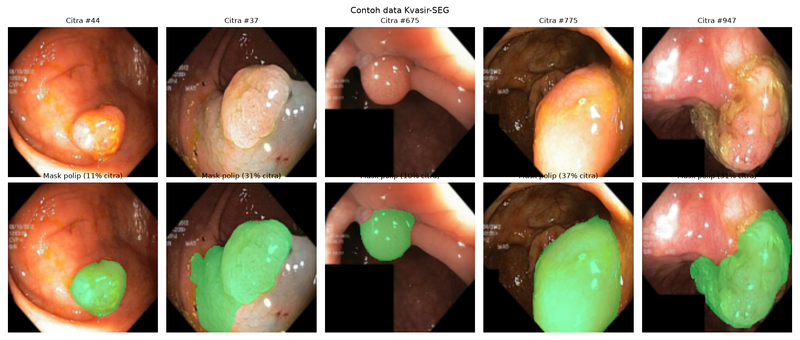
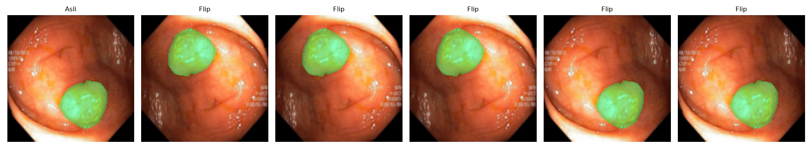
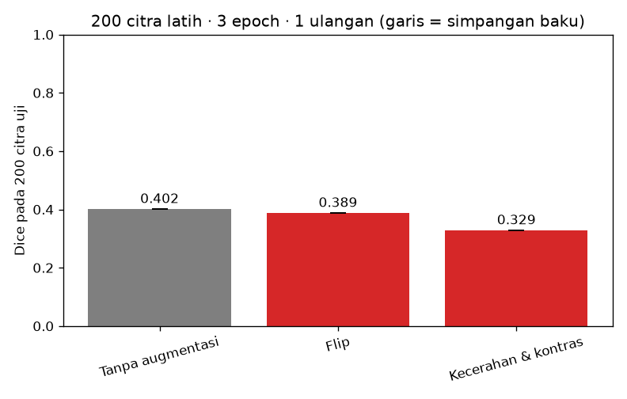
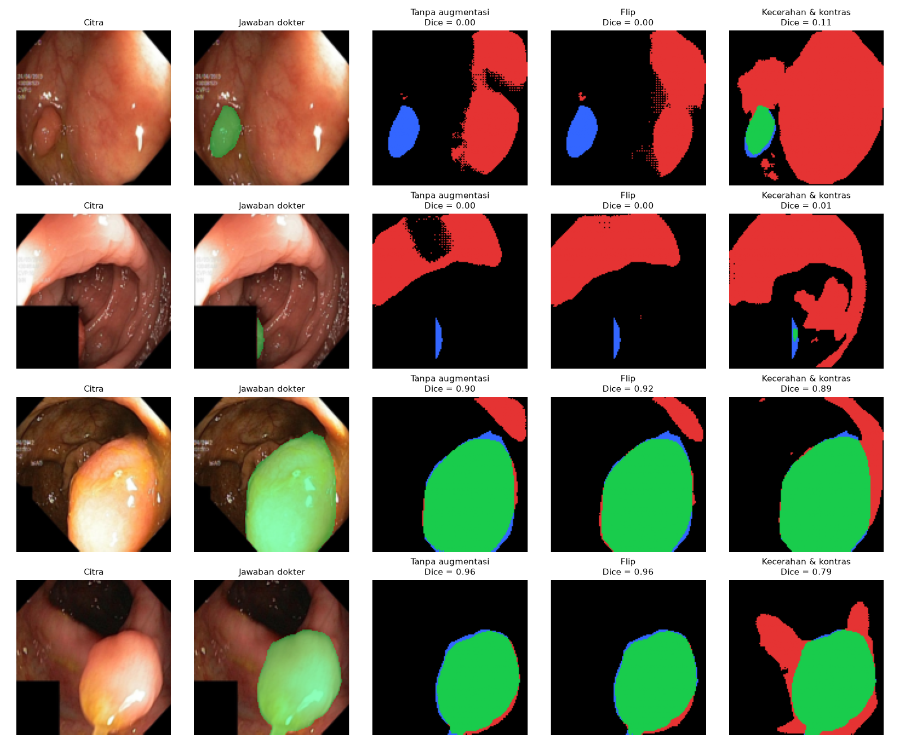

# Segmentasi Polip pada Citra Kolonoskopi dengan U-Net

<!--
  TEMPLATE LAPORAN — Tugas P10 Kecerdasan Buatan (BM25-41204), Teknik Biomedis ITERA.
  Petunjuk lengkap: https://mctm.web.id/ai-bm/tugas

  Cara memakai:
  - Ganti semua teks yang diawali "✍️" dengan tulisan kelompokmu, lalu hapus tanda ✍️-nya.
  - Blok komentar seperti ini adalah petunjuk; tidak tampil di GitHub. Boleh dihapus.
  - Gambar diambil dari folder hasil/ yang dibuat otomatis oleh notebook.
  - Jangan hapus judul-judul bagian (##).
-->

**Tugas P10 — Kecerdasan Buatan (BM25-41204), Teknik Biomedis ITERA**

## Anggota kelompok
| Nama | NIM | Username GitHub |
|---|---|---|
| Elisa Karunialita Sitorus | 123430073 | elisa123430073-bit |
| Arifa Lutfiah | 123430107 | arifa123430107-debug |
| Muhammad Rafi Adh Dhuha | 123430023 | rafi123430023-debug |
## 1. Pertanyaan

Augmentasi apa yang membantu U-Net menemukan polip pada citra kolonoskopi, dan augmentasi apa yang tidak? Kenapa?

## 2. Data & pengaturan

<!-- Isi dari Bagian 2 notebook. Pastikan CEPAT = False untuk hasil akhir. -->
- Dataset: Kvasir-SEG, berisi 1.000 citra kolonoskopi beserta mask polip, dengan resolusi citra diperkecil menjadi 128 × 128 piksel.
- Data uji: 200 citra.
- Data latih: 200 citra per eksperimen.
- Model: U-Net mini (sekitar 0,5 juta parameter).
- Epoch: 40.
- Pengulangan: 3 kali per skenario.
- Perangkat: Google Colab dengan GPU NVIDIA Tesla T4.
- Mode cepat: False (eksperimen akhir).


## 3. Skenario augmentasi & hipotesis

<!-- Tulis bagian ini SEBELUM menjalankan eksperimen. Commit dulu, baru jalankan.
     Alasan klinis = kenapa variasi ini mungkin (atau tidak mungkin) terjadi pada kolonoskopi sungguhan. -->

| Skenario | Augmentasi (kode) | Alasan klinis | Hipotesis: Dice naik/turun/sama? |
|---|---|---|---|
| Tanpa augmentasi | None |  Menjadi pembanding untuk melihat kemampuan dasar U-Net dalam mendeteksi polip.| Performa dasar sebagai baseline.|
| Flip | RandomHorizontalFlip dan RandomVerticalFlip (p=0.5) |  Membantu model mengenali polip pada berbagai posisi dan orientasi citra kolonoskopi. | Dice dapat meningkat karena variasi posisi, tetapi perlu dibuktikan. |
| Kecerahan & kontras | ColorJitter (brightness dan contrast 0.7–1.3) | Mensimulasikan perubahan pencahayaan dan kontras selama pemeriksaan kolonoskopi | Dapat meningkatkan ketahanan terhadap pencahayaan berbeda, tetapi perubahan berlebihan bisa menurunkan Dice. |

Contoh augmentasi yang dicoba:


<!-- Ganti nama file sesuai skenario kalian (lihat isi folder hasil/). -->

## 4. Hasil
| Skenario | Dice (rata-rata ± sb) | IoU (rata-rata ± sb) | Dice tiap ulangan |
|---|---|---|---|
| Tanpa augmentasi | 0.402 ± 0.000 | 0.283 ± 0.000 | 0.402 |
| Flip | 0.389 ± 0.000 | 0.271 ± 0.000 | 0.389 |
| Kecerahan & kontras | 0.329 ± 0.000 | 0.219 ± 0.000 | 0.329 |




## 5. Analisis peta kesalahan



<!-- Hijau = benar, merah = false positive, biru = false negative.
     Pertanyaan pemandu: Polip seperti apa yang sering terlewat (kecil? datar? warna mirip dinding usus?)
     Apa yang sering dikira polip padahal bukan? Apakah augmentasi memperbaiki kasus sulit? -->

✍️

## 6. Pembahasan & kesimpulan

<!-- Bandingkan hasil dengan hipotesis di Bagian 3. Hipotesis yang ternyata salah tetap bernilai,
     asalkan dijelaskan kenapa. Perbedaan kecil (lebih kecil dari simpangan baku) belum tentu berarti. -->

✍️

## 7. Pembagian kerja

<!-- Siapa mengerjakan apa. Penilaian proses kerja dilihat dari riwayat commit tiap anggota. -->

✍️

## 8. Penggunaan AI

<!-- Wajib diisi, walau tidak memakai AI (tulis "Tidak memakai AI").
     Contoh: "Claude Code (CLI) untuk menulis skenario augmentasi dan memperbaiki error di Bagian 4.
     Draf Bagian 6 ditulis sendiri, lalu dirapikan bahasanya dengan bantuan AI." -->

✍️

## Cara menjalankan ulang

```bash
uv sync
uv run jupyter lab segmentasi_polip.ipynb
```

Atau buka notebook di Google Colab (Runtime → Change runtime type → T4 GPU).

## Referensi

- Jha, D., dkk. (2020). Kvasir-SEG: A Segmented Polyp Dataset. *MultiMedia Modeling (MMM 2020)*, 451–462.
- Ronneberger, O., Fischer, P., & Brox, T. (2015). U-Net: Convolutional Networks for Biomedical Image Segmentation. *MICCAI*. arXiv:1505.04597.
- ✍️ tambahkan referensi lain yang kalian pakai
